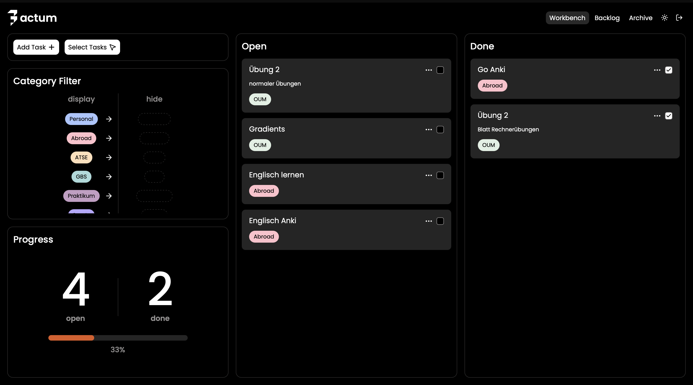
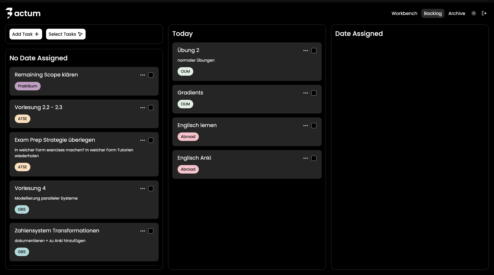
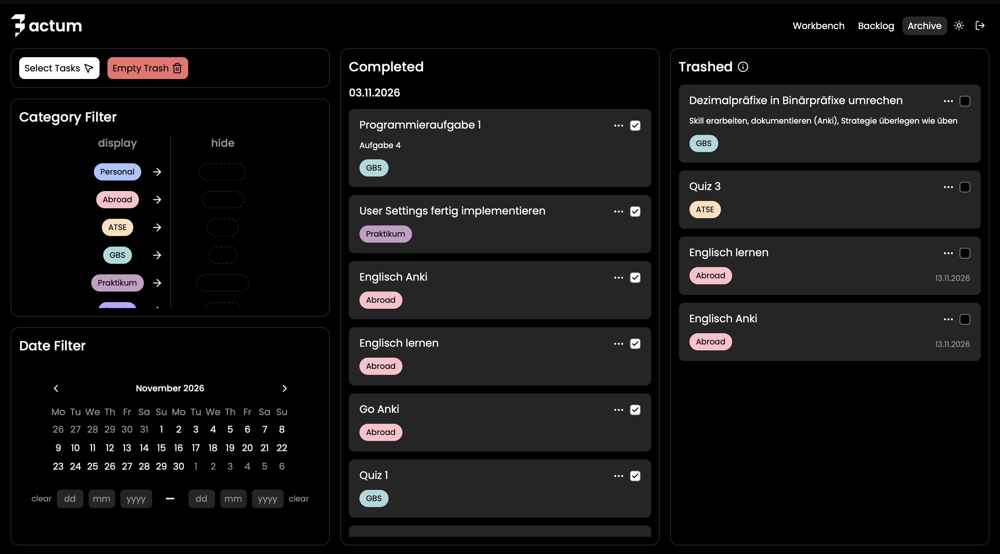

# Factum

## Purpose

I’m building Factum to have access to a free task manager that fits my everyday task management workflow exactly. It has precisely the functionality I need, without any additional feature bloat.

Another goal that motivates this project is learning by doing: I want to become proficient with Svelte and Go and eventually learn about secure, production-grade deployment. My final goal is to deploy this tool so my friends and I can use it like any other app without having to run it locally.

## Features

### Workbench

Focus on today’s tasks, filter by category, and track your progress. Check off tasks as you complete them. Drag and drop tasks to reorder them or move them between Open and Done. Select multiple tasks for batch operations.



### Backlog

Create, edit, and schedule your tasks. Drag and drop to reorder tasks, or move them between columns to assign, change, or remove dates.



### Archive

Browse completed and trashed tasks. Filter completed tasks by date and category, reopen tasks, or drag and drop them between Completed and Trashed. Select multiple tasks for batch operations or empty the trash.



## Local Setup

Make sure ports `3001`, `5173`, and `5435` are available. Run the server and client in separate terminals.

### Server

Required installations:

- Go 1.25.6 or newer
- Make
- Docker Desktop
- golang-migrate with PostgreSQL support

From the repository root, start the local database, apply the migrations, and run the server. The local server prints sign-up verification links to its console and does not send emails. Any syntactically valid email address works without a real inbox. Replace `you@example.com` below with the email address you want to use.

```sh
cd server
make containers-up
make migrate-up n=all
make run SIGN_UP_EMAIL_WHITELIST=you@example.com
```

The server listens on port `3001`.

### Client

Required installations:

- Node.js 24
- npm

From the repository root, install dependencies and run the client:

```sh
cd client
npm ci
npm start
```

The client is available at [http://localhost:5173](http://localhost:5173).
